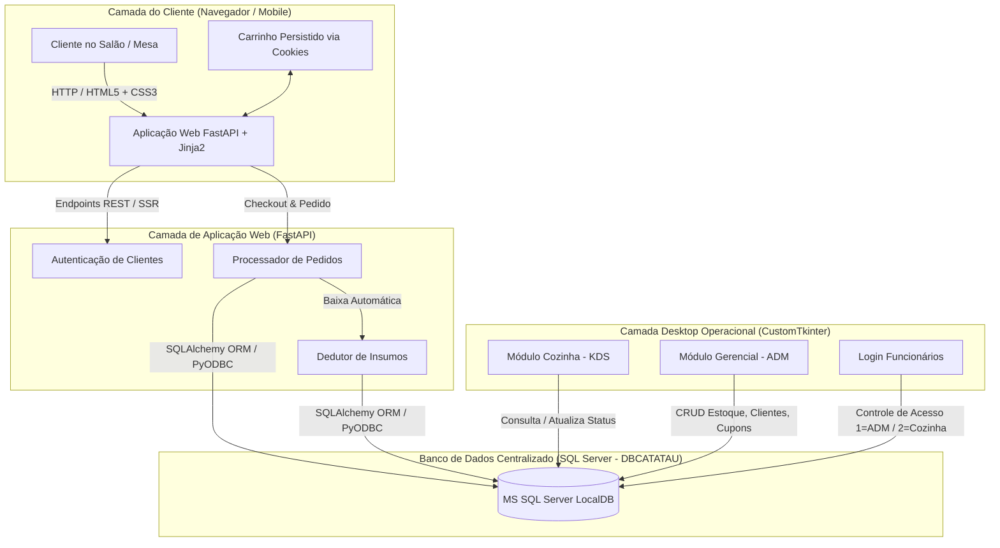
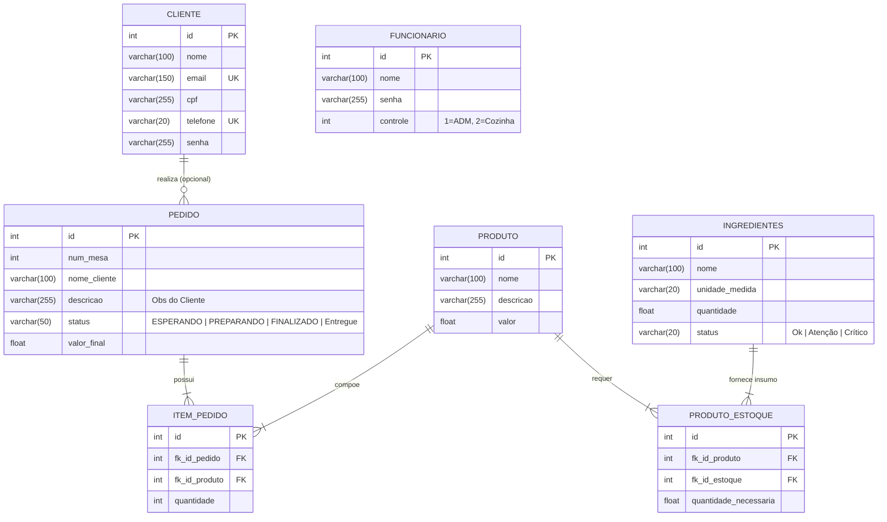
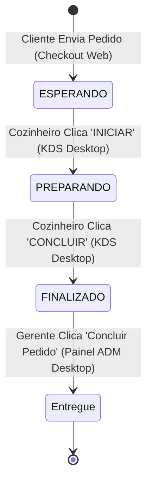
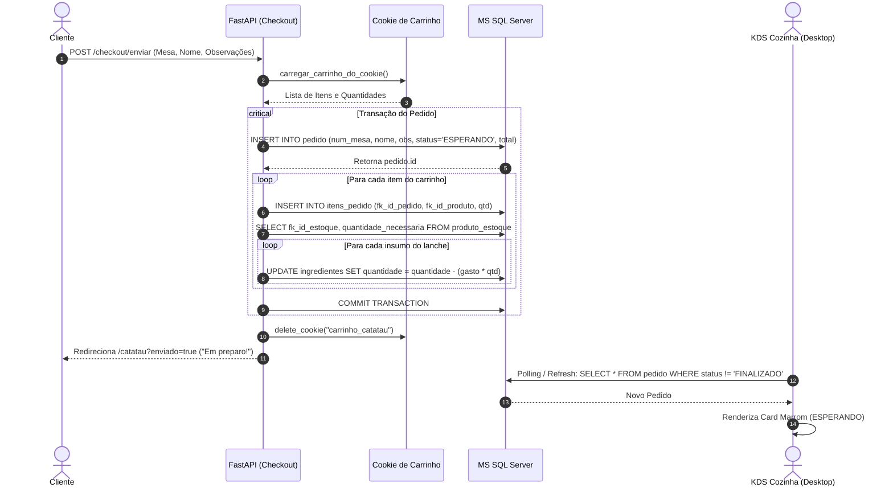

# Especificação de Requisitos de Software (ERS)
## Projeto Integrador: Sistema Integrado de Gestão e Autoatendimento "Catatau Lanches"

---

### Informações do Documento
* **Projeto:** Catatau Lanches - Sistema Integrado Full-Stack de Autoatendimento e Gestão
* **Natureza:** Projeto Integrador / Trabalho de Conclusão de Curso
* **Versão do Documento:** 1.0
* **Data:** 14 de Outubro de 2026
* **Status:** Concluído / Pronto para Avaliação de Banca
* **Tecnologias Envolvidas:** 
  * **Backend & Web:** Python 3.14, FastAPI, Jinja2, Starlette, Uvicorn
  * **Frontend Web:** HTML5, CSS3 Semântico e Responsivo, Vanilla JS / Cookies de Sessão
  * **Módulo Desktop:** Python, CustomTkinter, Pillow (PIL)
  * **Persistência de Dados & ORM:** Microsoft SQL Server (LocalDB `DBCATATAU`), SQLAlchemy 2.0, PyODBC

---

## 1. Introdução e Contextualização do Projeto

### 1.1. Objetivo Geral
Desenvolver e integrar uma solução computacional completa (Full-Stack) voltada ao segmento de alimentação rápida (hamburgueria artesanal / "podrão raiz"). A solução centraliza o fluxo operacional desde a ponta do consumidor (autoatendimento digital na mesa via interface Web) até a operação da linha de produção (KDS - *Kitchen Display System* em terminal desktop) e o controle gerencial estratégico (retaguarda administrativa com controle de estoque de insumos, relatórios e auditoria de pedidos).

### 1.2. O Problema de Negócio
No modelo tradicional de lanchonetes e hamburguerias de alta rotatividade, observam-se gargalos frequentes:
1. **Erros de anotação de comandas físicas:** caligrafia ilegível, esquecimento de observações de ingredientes (ex.: sem cebola, ponto da carne).
2. **Desconexão entre vendas e estoque:** ingredientes acabam durante o expediente sem aviso prévio, gerando retrabalho no salão e cancelamento de pedidos.
3. **Falta de visibilidade em tempo real:** a cozinha não sabe a ordem cronológica estrita de preparo e o gerente não possui visão unificada do faturamento do dia e do volume de clientes.

### 1.3. A Proposta da Solução (Escopo)
O sistema **Catatau Lanches** atua como uma plataforma unificada que conecta três ecossistemas em torno de uma base de dados relacional centralizada:
1. **Portal Web de Autoatendimento do Cliente:** Permite consulta de cardápio interativo, montagem de carrinho dinâmico persistido localmente via cookies HTTP, cadastro/login do cliente e envio do pedido com identificação de mesa e observações personalizadas.
2. **Terminal Desktop da Cozinha (KDS):** Painel operacional touch-friendly em CustomTkinter para os chapeiros e cozinheiros, exibindo pedidos em fila cronológica com cards dinâmicos coloridos por status (`ESPERANDO` -> `PREPARANDO` -> `FINALIZADO`), cálculo de tempo e histórico de produção.
3. **Terminal Desktop de Retaguarda Administrativa (Gerência):** Painel executivo com dashboards de vendas, monitoramento global de comandas, cadastro e edição de insumos com alertas visuais de ponto de pedido (crítico/atenção), emissão de relatórios, módulo de cupons e gestão da carteira de clientes cadastrados.
4. **Mecanismo Automático de Baixa Técnica de Insumos:** Desconto automático no estoque de cada ingrediente proporcionalmente aos lanches produzidos no momento em que a comanda é emitida.

---

## 2. Arquitetura da Solução e Diagrama do Ecossistema

---

## 3. Atores e Perfis de Usuário

| Ator | Descrição | Canal de Acesso | Nível de Acesso |
| :--- | :--- | :--- | :--- |
| **Cliente Consumidor** | Usuário final do salão. Acessa o cardápio, seleciona itens, realiza cadastro/login, personaliza lanches e finaliza a comanda. | Web (Navegador Desktop / Smartphone) | Público / Cliente Autenticado |
| **Operador de Cozinha (Chapeiro/Cozinheiro)** | Funcionário da linha de produção. Recebe as comandas eletrônicas, acompanha observações de preparo, altera status para "PREPARANDO" e "FINALIZADO". | Aplicação Desktop (`CozinhaApp`) | Operacional (`controle = 2`) |
| **Gerente / Administrador** | Responsável pelo fechamento de caixa, acompanhamento financeiro, reposição e ajuste de estoque de insumos, auditoria de pedidos e fidelização. | Aplicação Desktop (`PaginaADM`) | Administrativo (`controle = 1`) |

---

## 4. Requisitos Funcionais (RF)

Os requisitos funcionais estão agrupados por módulos operacionais e priorizados segundo a técnica **MoSCoW** (*Must have*, *Should have*, *Could have*, *Won't have*).

### 4.1. Módulo Web: Autoatendimento e Identificação do Cliente

#### [RF01] Catálogo de Produtos e Cardápio Digital
* **Prioridade:** Must have
* **Ator Principal:** Cliente Consumidor
* **Descrição:** O sistema deve disponibilizar um cardápio digital estruturado apresentando os lanches disponíveis com suas respectivas fotos, nomes, descrições detalhadas e valores monetários unitários.
* **Entradas:** Seleção da categoria ou lanche individual.
* **Processamento:** Busca na base de dados (`produto`) ou exibição por rotas parametrizadas (`/cardapio`, `/lanche/{nome}`).
* **Saídas:** Interface visual contendo a listagem dos lanches e suas fichas descritivas.

#### [RF02] Gestão de Carrinho de Compras via Cookies
* **Prioridade:** Must have
* **Ator Principal:** Cliente Consumidor
* **Descrição:** O sistema deve permitir a inclusão, incremento, decremento e exclusão de itens no carrinho de compras sem exigir armazenamento prévio na base relacional antes da conclusão da compra.
* **Entradas:** `item_id`, ação (`aumentar`, `diminuir`, remoção total).
* **Processamento:** Leitura, manipulação e gravação de um cookie HTTP (`carrinho_catatau`) em formato serializado JSON contendo o par `{"produto_id": quantidade}`.
* **Saídas:** Sidebar/gaveta retrátil do carrinho atualizada em tempo real com subtotal e totalizador.

#### [RF03] Cadastro e Validação Cadastral de Clientes
* **Prioridade:** Must have
* **Ator Principal:** Cliente Consumidor
* **Descrição:** O sistema deve permitir que novos clientes criem uma conta informando Nome Completo, E-mail, CPF, Telefone (DDD + Número) e Senha de Acesso com confirmação.
* **Regra de Validação:** A senha e a confirmação devem ser rigorosamente idênticas. Não são permitidos registros duplicados de Nome, E-mail ou CPF.
* **Processamento:** Inserção na tabela `cliente`.
* **Saídas:** Redirecionamento para a página de perfil `/usuario/{nome}` com exibição dos dados cadastrados ou mensagem explicativa em caso de duplicidade/divergência.

#### [RF04] Autenticação e Sessão Web de Clientes
* **Prioridade:** Must have
* **Ator Principal:** Cliente Consumidor
* **Descrição:** O sistema deve autenticar o cliente através do Nome de Usuário ou E-mail combinado com sua respectiva Senha.
* **Processamento:** Consulta à tabela `cliente`. Caso autenticado, emite um cookie `user_id` HTTPOnly (com validade de 1 hora e atributo `samesite="lax"`).
* **Saídas:** Liberação da área do cliente, personalização do cabeçalho com avatar e nome, e pré-preenchimento de dados de checkout.

#### [RF05] Envio de Pedido e Identificação de Mesa (Checkout)
* **Prioridade:** Must have
* **Ator Principal:** Cliente Consumidor
* **Descrição:** A tela de checkout deve exigir o preenchimento do Nome do Cliente e do Número da Mesa (ou indicação de Balcão), além de um campo opcional para Observações / Restrições alimentares (ex.: "sem cebola", "carne bem passada").
* **Processamento:**
  1. Criação do registro na tabela `pedido` com status inicial `ESPERANDO`.
  2. Criação dos registros vinculados na tabela `itens_pedido`.
  3. Limpeza do cookie de carrinho (`carrinho_catatau`).
* **Saídas:** Redirecionamento para a página inicial com mensagem de confirmação: *"SEU LANCHE FOI ENVIADO PARA A COZINHA! SEU PEDIDO SERÁ ENTREGUE EM 10 MINUTOS!"*.

#### [RF06] Dedução Automática de Insumos (Ficha Técnica)
* **Prioridade:** Must have
* **Ator Principal:** Sistema (Automático)
* **Descrição:** Ao persistir o pedido e seus respectivos itens, o sistema deve consultar a composição de cada produto na tabela `produto_estoque` e subtrair a quantidade equivalente de cada ingrediente na tabela `ingredientes`.
* **Fórmula:** $\text{Quantidade Atual} = \text{Quantidade Atual} - (\text{Quantidade Necessária por Lanche} \times \text{Quantidade de Lanches Pedidos})$.
* **Processamento:** Operação transacional atômica vinculada ao commit do pedido.

---

### 4.2. Módulo Desktop: Terminal Operacional de Cozinha (KDS)

#### [RF07] Autenticação Operacional com Níveis de Acesso
* **Prioridade:** Must have
* **Ator Principal:** Operador de Cozinha / Administrador
* **Descrição:** O aplicativo desktop deve solicitar credenciais de usuário e senha validadas na tabela `funcionario`. Se o campo `controle` for igual a `2`, o sistema direciona automaticamente para a interface da Cozinha (`CozinhaApp`). Se for igual a `1`, direciona para o Painel Administrativo (`PaginaADM`).

#### [RF08] Painel Visual de Comandas em Aberto (Kanban KDS)
* **Prioridade:** Must have
* **Ator Principal:** Operador de Cozinha
* **Descrição:** Apresentar em grade dimensional cards representando pedidos com status `ESPERANDO` e `PREPARANDO`. Cada card deve evidenciar:
  * Número da Mesa ou Balcão em destaque;
  * Identificador numérico do pedido (`#ID`);
  * Nome do cliente;
  * Lista discriminada de itens e quantidades ($2\times \text{X-Burger}$);
  * Bloco de destaque para Observações especiais do cliente;
  * Identificação visual de status e cor correspondente.

#### [RF09] Transição de Status Operacional do Pedido
* **Prioridade:** Must have
* **Ator Principal:** Operador de Cozinha
* **Descrição:** O operador de cozinha deve poder avançar o status da comanda por meio de botões contextuais no rodapé do card:
  * De `ESPERANDO` para `PREPARANDO` (Botão "INICIAR");
  * De `PREPARANDO` para `FINALIZADO` (Botão "CONCLUIR").
* **Processamento:** Atualização instantânea da coluna `status` na tabela `pedido` e recarregamento visual da tela.

#### [RF10] Histórico de Produção da Cozinha
* **Prioridade:** Should have
* **Ator Principal:** Operador de Cozinha
* **Descrição:** Permitir a alternância para a visualização de histórico, listando exclusivamente os pedidos com status `FINALIZADO`, exibindo contador de pedidos prontos versus o total do dia.

---

### 4.3. Módulo Desktop: Retaguarda Administrativa e Gerencial

#### [RF11] Dashboard de Indicadores em Tempo Real
* **Prioridade:** Must have
* **Ator Principal:** Gerente / Administrador
* **Descrição:** Exibir visão sintetizada do negócio, incluindo:
  * Valor total de vendas brutas do dia;
  * Ranking dos lanches mais vendidos (*Top Lanches*);
  * Widget de Insumos em Estado Crítico com barras de progresso;
  * Espaço dedicado para demonstrativo financeiro dos últimos 7 dias.

#### [RF12] Monitoramento e Encerramento Global de Pedidos
* **Prioridade:** Must have
* **Ator Principal:** Gerente / Administrador
* **Descrição:** Apresentar tabela detalhada com todos os pedidos do sistema (ID, Mesa, Cliente, Resumo de Itens, Valor Total, Status atual).
* **Funcionalidade:** Modal de "Detalhes do Pedido" com discriminação de itens, preços unitários, subtotais e botão "Concluir Pedido", que transiciona o status para `Entregue`.

#### [RF13] Gestão de Estoque e Matéria-Prima (CRUD de Insumos)
* **Prioridade:** Must have
* **Ator Principal:** Gerente / Administrador
* **Descrição:** Permitir a visualização, cadastro e edição de insumos da tabela `ingredientes`.
* **Atributos Manipulados:** Nome do insumo, Quantidade atual (com precisão decimal) e Nível de criticidade (`Ok`, `Atenção`, `Crítico`).
* **Interface:** Tabela rolável com botões de "Adicionar Item" e "Editar", abrindo janela modal dedicada.

#### [RF14] Base de Clientes e Histórico de Relacionamento
* **Prioridade:** Should have
* **Ator Principal:** Gerente / Administrador
* **Descrição:** Listar todos os clientes cadastrados na plataforma com nome, telefone formatado, volume total de pedidos realizados e tag de perfil (`Regular`, `VIP`).

#### [RF15] Gestão e Lançamento de Cupons de Desconto
* **Prioridade:** Could have
* **Ator Principal:** Gerente / Administrador
* **Descrição:** Módulo para cadastro de cupons promocionais contendo código identificador (ex.: `CATATAU10`), percentual de desconto associado e status de vigência (`Ativo`/`Inativo`).

#### [RF16] Geração de Relatórios Gerenciais
* **Prioridade:** Could have
* **Ator Principal:** Gerente / Administrador
* **Descrição:** Interface para geração de relatórios de fechamento mensal, curva ABC de ingredientes consumidos e estatística de tempo médio de atendimento do pedido.

---

## 5. Regras de Negócio (RN)

| Código | Nome da Regra | Descrição e Critério de Aceite |
| :--- | :--- | :--- |
| **RN01** | **Persistência de Carrinho Desconectada** | O carrinho não consome transações de banco até o envio. Fica armazenado em cookie seguro HTTP serializado em JSON com validade vinculada ao navegador. |
| **RN02** | **Consistência do Checkout** | Nenhum pedido pode ser concluído com carrinho vazio ($\text{total} \le 0$). É obrigatória a indicação do número da mesa (inteiro positivo ou zero para balcão) e nome do cliente. |
| **RN03** | **Atomicidade da Baixa de Estoque** | A dedução dos insumos deve ocorrer no mesmo ciclo transacional da criação do pedido. Caso ocorra erro de persistência em qualquer item ou ingrediente, deve ser disparado *rollback* integral. |
| **RN04** | **Máquina de Estados do Pedido** | O fluxo de estados do pedido é estritamente sequencial: $\text{ESPERANDO} \longrightarrow \text{PREPARANDO} \longrightarrow \text{FINALIZADO} \longrightarrow \text{Entregue}$. Não é permitida regressão de status. |
| **RN05** | **Segregação de Papéis Desktop** | O acesso ao aplicativo desktop é determinado pela coluna `funcionario.controle`: valor `1` autoriza acesso ao módulo administrativo; valor `2` bloqueia o módulo gerencial e direciona exclusivamente à visualização de produção da cozinha. |
| **RN06** | **Unicidade de Identificação do Cliente** | No ato do cadastro de clientes, os campos `email`, `cpf` e `telefone` devem ser estritamente únicos na base de dados. O sistema rejeita o cadastro se houver duplicata. |
| **RN07** | **Parametrização Visual do Estoque** | Insumos cujo volume atinja o limiar inferior de segurança devem receber classificação visual diferenciada: Amarelo para `Atenção` e Laranja/Vermelho para `Crítico`. |

---

## 6. Requisitos Não Funcionais (RNF)

### 6.1. RNF de Desempenho e Eficiência
* **[RNF01] Tempo de Resposta Web:** As páginas renderizadas pelo Jinja2 devem ter tempo de resposta inferior a 500 ms sob carga média de rede local.
* **[RNF02] Otimização de Imagens:** Recursos gráficos estáticos (fotos de lanches, banners promocionais) devem ser servidos em formatos compactados e cacheados localmente no navegador.

### 6.2. RNF de Segurança e Privacidade
* **[RNF03] Proteção de Cookies de Sessão:** Cookies de autenticação (`user_id`) e de carrinho devem empregar flags `HttpOnly` (prevenção contra ataques Cross-Site Scripting - XSS) e `SameSite=Lax` (mitigação de Cross-Site Request Forgery - CSRF).
* **[RNF04] Isolamento de Camada de Dados:** Nenhuma instrução SQL direta deve ser concatenada por string. Todas as consultas devem utilizar parâmetros mapeados pelo SQLAlchemy ORM para eliminar vulnerabilidades de *SQL Injection*.
* **[RNF05] Conformidade com LGPD:** Dados de clientes (CPF, Telefone, E-mail) são de uso restrito operacional e devem ser protegidos contra exposição pública no endpoint `/administrator`.

### 6.3. RNF de Usabilidade e Ergonomia de Interface
* **[RNF06] Responsividade Mobile Web:** O cardápio web deve ser 100% responsivo para visualização fluida em smartphones de clientes sentados à mesa (largura mínima de 360 px), apresentando menu gaveta retrátil inferior/lateral.
* **[RNF07] Ergonomia Visual do KDS (Cozinha):** A tela da cozinha em CustomTkinter deve utilizar tipografia ampliada, botões táteis de grandes dimensões (mínimo de 35 px de altura) e alto contraste entre o fundo (#F7F0E6) e os cards (#FFFFFF), visando operação rápida e sem ambiguidades em ambiente de cozinha quente.

### 6.4. RNF Tecnológicos e de Manutenibilidade
* **[RNF08] Persistência Relacional ACID:** Utilização do Microsoft SQL Server com driver oficial ODBC Driver 17, garantindo integridade referencial por chaves estrangeiras com ação de deleção em cascata (`cascade="all, delete-orphan"`) em pedidos e itens de pedido.
* **[RNF09] Desacoplamento Arquitetural:** O código-fonte divide-se claramente em módulos de Modelos (`models.py`/`Tabelas.py`), Configuração/Conexão (`Banco.py`), Camada de Apresentação Web (`templates/`, `static/`), e Módulos Desktop por Contexto (`paginaCozinha/`, `paginasADM/`).

---

## 7. Modelagem de Dados e Dicionário de Tabelas

### 7.1. Diagrama Entidade-Relacionamento (Mermaid)

### 7.2. Especificação do Dicionário de Dados

#### Tabela: `cliente`
Armazena a carteira de consumidores que utilizam o sistema web.
* `id` (INTEGER, PK, Autoincrement): Identificador único do cliente.
* `nome` (VARCHAR(100), NOT NULL): Nome completo do cliente.
* `email` (VARCHAR(150), UNIQUE, NULLABLE): Endereço de correio eletrônico.
* `cpf` (VARCHAR(255), NOT NULL): Documento de CPF.
* `telefone` (VARCHAR(20), UNIQUE, NULLABLE): Telefone no formato unificado (DDD + Número).
* `senha` (VARCHAR(255), NOT NULL): Hash/credencial de autenticação.

#### Tabela: `funcionario`
Controla os operadores internos dos terminais desktop.
* `id` (INTEGER, PK, Autoincrement): Identificador único do funcionário.
* `nome` (VARCHAR(100), NOT NULL): Nome ou login do colaborador.
* `senha` (VARCHAR(255), NOT NULL): Senha de acesso.
* `controle` (INTEGER, NOT NULL): Papel de autorização (`1 = Gerente/Administrador`, `2 = Cozinha/Produção`).

#### Tabela: `produto`
Catálogo de lanches comercializados pela hamburgueria.
* `id` (INTEGER, PK, Autoincrement): Código do lanche.
* `nome` (VARCHAR(100), NOT NULL): Nome comercial (ex: "King Bacon").
* `descricao` (VARCHAR(255), NULLABLE): Ingredientes principais e detalhes.
* `valor` (FLOAT, NOT NULL): Preço de venda unitário em reais (R$).

#### Tabela: `pedido`
Registra o cabeçalho de cada pedido expedido.
* `id` (INTEGER, PK, Autoincrement): Número da comanda/pedido.
* `num_mesa` (INTEGER, NOT NULL): Número da mesa do salão (ou 0 para balcão).
* `nome_cliente` (VARCHAR(100), NULLABLE): Identificação do solicitante.
* `descricao` (VARCHAR(255), NULLABLE): Observações personalizadas inseridas no checkout.
* `status` (VARCHAR(50), NOT NULL): Situação atual (`ESPERANDO`, `PREPARANDO`, `FINALIZADO`, `Entregue`).
* `valor_final` (FLOAT, DEFAULT 0.0): Valor total consolidado do pedido.

#### Tabela: `itens_pedido`
Tabela relacional associativa que discrimina os produtos e quantidades de cada comanda.
* `id` (INTEGER, PK, Autoincrement): Identificador do item de pedido.
* `fk_id_pedido` (INTEGER, FK `pedido.id`, NOT NULL): Comanda associada.
* `fk_id_produto` (INTEGER, FK `produto.id`, NOT NULL): Lanche solicitado.
* `quantidade` (INTEGER, NOT NULL): Unidades solicitadas.

#### Tabela: `ingredientes`
Cadastro e saldo de matéria-prima para confecção dos lanches.
* `id` (INTEGER, PK, Autoincrement): Código do insumo.
* `nome` (VARCHAR(100), NOT NULL): Nome do ingrediente (ex: Pão, Carne, Bacon).
* `unidade_medida` (VARCHAR(20), NOT NULL): Unidade (unidades, kg, g).
* `quantidade` (FLOAT/NUMERIC(10,2), NOT NULL): Saldo atual disponível em estoque.
* `status` (VARCHAR(20), NOT NULL): Alerta de abastecimento (`Ok`, `Atenção`, `Crítico`).

#### Tabela: `produto_estoque`
Ficha técnica que dita o consumo de cada ingrediente por produto.
* `id` (INTEGER, PK, Autoincrement): Identificador da composição.
* `fk_id_produto` (INTEGER, FK `produto.id`, NOT NULL): Lanche correspondente.
* `fk_id_estoque` (INTEGER, FK `ingredientes.id`, NOT NULL): Insumo consumido.
* `quantidade_necessaria` (FLOAT/NUMERIC(10,2), NOT NULL): Fração gasta por unidade de lanche produzida.

---

## 8. Diagramas de Sequência e Ciclo de Vida do Pedido

### 8.1. Ciclo de Vida de Status do Pedido (Máquina de Estados)

### 8.2. Diagrama de Sequência: Envio de Pedido e Baixa de Estoque

---

## 9. Matriz de Rastreabilidade (Requisitos x Código-Fonte)

| ID Requisito | Descrição Sintética | Arquivo de Implementação | Função / Rota Correspondente |
| :--- | :--- | :--- | :--- |
| **RF01** | Cardápio Digital e Lanches | `DB-Jinja2-Python/main.py` | `GET /cardapio`, `GET /lanche/{nome}` |
| **RF02** | Carrinho em Cookies | `DB-Jinja2-Python/main.py` | `POST /carrinho/adicionar`, `/atualizar`, `/remover` |
| **RF03** | Cadastro de Clientes | `DB-Jinja2-Python/main.py` | `POST /cadastro` |
| **RF04** | Login e Sessão de Clientes | `DB-Jinja2-Python/main.py` | `POST /login`, `GET /logout` |
| **RF05** | Finalização do Pedido (Checkout) | `DB-Jinja2-Python/main.py` | `GET /checkout`, `POST /checkout/enviar` |
| **RF06** | Baixa Técnica de Insumos | `DB-Jinja2-Python/main.py` | `POST /checkout/enviar` (linhas 136–143) |
| **RF07** | Autenticação no Desktop | `Desktop Tkinter Gestão/paginas/pagina_login.py` | `acao_login()` |
| **RF08** | Visualização KDS de Pedidos | `Desktop Tkinter Gestão/paginas/paginaCozinha/pedidos.py` | `carregar_pedidos()`, `create_order_card()` |
| **RF09** | Transição de Status na Cozinha | `Desktop Tkinter Gestão/paginas/paginaCozinha/pedidos.py` | `alterar_status_pedido()` |
| **RF10** | Histórico de Pedidos da Cozinha | `Desktop Tkinter Gestão/paginas/paginaCozinha/historico.py` | `HistoricoApp.carregar_pedidos()` |
| **RF11** | Dashboard Gerencial de Indicadores | `Desktop Tkinter Gestão/paginas/paginasADM/dashboard_view.py` | `DashboardView.__init__()` |
| **RF12** | Gerenciamento de Pedidos e Detalhes | `Desktop Tkinter Gestão/paginas/paginasADM/pedidos_view.py` | `PedidosView`, `DetalhesPedidoModal` |
| **RF13** | Controle e CRUD de Estoque | `Desktop Tkinter Gestão/paginas/paginasADM/estoque_view.py` | `EstoqueView`, `ModalItemEstoque`, `salvar_item()` |
| **RF14** | Carteira de Clientes Cadastrados | `Desktop Tkinter Gestão/paginas/paginasADM/clientes_view.py` | `ClientesView.carregar_clientes()` |
| **RF15** | Módulo de Cupons de Desconto | `Desktop Tkinter Gestão/paginas/paginasADM/cupons_view.py` | `CuponsView` |
| **RF16** | Relatórios e Fechamento | `Desktop Tkinter Gestão/paginas/paginasADM/relatorios_view.py` | `RelatoriosView` |

---

## 10. Recomendações e Plano de Evolução para Apresentação em Banca

Para obter nota máxima na defesa do Projeto Integrador perante a banca avaliadora, recomenda-se destacar os seguintes pontos de evolução futura (Trabalhos Futuros):

1. **Criptografia e Hashing de Senhas:** Atualmente as senhas são comparadas em texto plano. A implementação de algoritmos de derivação de chave como `bcrypt` ou `Argon2` elevará o projeto ao padrão internacional OWASP.
2. **Atualização em Tempo Real (Push / WebSockets):** A interface da cozinha atualmente recarrega por evento do usuário. A inclusão de Server-Sent Events (SSE) ou WebSockets no FastAPI permitirá que novos pedidos apareçam com efeito sonoro instantâneo no terminal da cozinha sem necessidade de refresh manual.
3. **Módulo de Cupons Conectado ao Checkout:** Conectar os cupons cadastrados no desktop para que o cliente possa inseri-los no formulário de checkout web e receber desconto automático no valor total.
4. **Integração com Gateway de Pagamento:** Adição de geração de QR Code dinâmico do PIX (via API Mercado Pago ou similar) na tela de confirmação de pedido.
5. **Comunicação Segura de Produção:** Migração do arquivo de configuração de banco de dados (`Banco.py`) para carregamento de variáveis de ambiente (`.env` com `python-dotenv`), ocultando credenciais e caminhos do repositório público.
